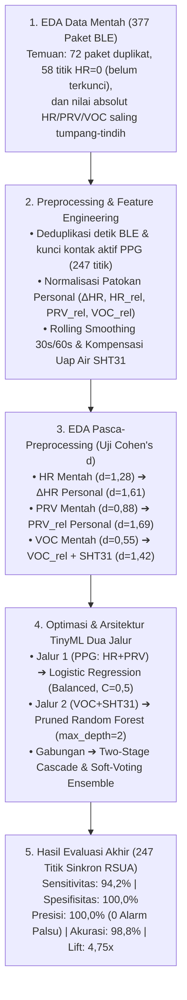

# Dokumentasi *Pipeline Machine Learning* (TinyML) & Integrasi Firmware ESP32 — HypoSense

Folder `ml_fix_pipeline` ini berisi rangkaian lengkap eksperimen *Data Science* dan *TinyML* untuk perangkat **`HypoSense-001`** berbasis data primer hasil uji klinis di **Rumah Sakit Universitas Airlangga (RSUA)** (`clinical_measurements_rsua.csv`), mulai dari eksplorasi data mentah (*EDA*), pembersihan & rekayasa fitur (*Preprocessing & Feature Engineering*), evaluasi daya pisah (*EDA Pasca-Preprocess*), pemodelan & optimasi *Machine Learning*, hingga kode firmware **ESP32-C3 (`hyposense_esp32_ble.ino`)** yang telah ditanamkan model gabungan kedua jalur.

---

## 1. Struktur File di Dalam Folder Ini

| Nama File | Deskripsi & Fungsi |
| :--- | :--- |
| [`00_Master_Pipeline_Lengkap_HypoSense.ipynb`](./00_Master_Pipeline_Lengkap_HypoSense.ipynb) | **Notebook Utama (*All-in-One*)**: Menggabungkan seluruh tahapan (`01` s.d. `04`) dalam satu file `.ipynb` utuh dari awal hingga akhir. |
| [`01_EDA_Data_Mentah_RSUA.ipynb`](./01_EDA_Data_Mentah_RSUA.ipynb) | **Tahap 1 — EDA Data Mentah**: Audit kualitas data mentah BLE ($377$ paket mentah dari $5$ partisipan RSUA), identifikasi paket duplikat BLE, fase belum terkuncinya sensor PPG (`hr == 0`), serta visualisasi tumpang-tindih (*overlap*) nilai absolut antar-subjek. |
| [`02_Preprocessing_dan_Feature_Engineering.ipynb`](./02_Preprocessing_dan_Feature_Engineering.ipynb) | **Tahap 2 — *Preprocessing & Feature Engineering***: Deduplikasi timestamp BLE, penguncian jendela aktif PPG (`hr > 0`), ekstraksi patokan personal kausal (`hr_base`, `prv_base`, `voc_base`), penghalusan jendela bergulir (*rolling window* $30\text{s}$ & $60\text{s}$), serta kompensasi *noise* uap air/suhu kabin napas menggunakan sensor **SHT31** (`voc_rel_comp`). Menghasilkan [`dataset_klinis_rsua_clean.csv`](./dataset_klinis_rsua_clean.csv). |
| [`03_EDA_Pasca_Preprocessing_dan_Separabilitas.ipynb`](./03_EDA_Pasca_Preprocessing_dan_Separabilitas.ipynb) | **Tahap 3 — EDA Pasca-*Preprocessing***: Membuktikan secara kuantitatif lonjakan daya pisah fitur (*Cohen's $d$*) sebelum vs. sesudah normalisasi patokan personal, serta memetakan ruang fitur 2D yang memperlihatkan pemisahan tegas antara pasien Hipoglikemia dan Normal. |
| [`04_Modeling_Optimasi_dan_Evaluasi_TinyML.ipynb`](./04_Modeling_Optimasi_dan_Evaluasi_TinyML.ipynb) | **Tahap 4 — Optimasi Model, Evaluasi, & Ekspor C++**: Penanganan ketimpangan kelas (`class_weight='balanced'`), pemangkasan pohon (*tree pruning* `max_depth=2`), evaluasi *5-Fold Stratified Cross-Validation* pada **Jalur 1 (`LogisticRegression`)**, **Jalur 2 (`RandomForestClassifier`)**, dan **Gabungan Kedua Jalur (*Cascade & Soft-Voting Ensemble*)**, serta ekspor parameter bobot ke C++ ESP32. |
| [`hyposense_esp32_ble.ino`](./hyposense_esp32_ble.ino) | **Salinan Kode Firmware ESP32-C3 Terbaru** (juga diperbarui langsung di [`../hyposense-aplikasi/esp32/hyposense_esp32_ble/hyposense_esp32_ble.ino`](../hyposense-aplikasi/esp32/hyposense_esp32_ble/hyposense_esp32_ble.ino)) yang sudah menanamkan inferensi **Logistic Regression (Jalur 1)** + **Pruned Random Forest (Jalur 2)** + **Cascade Soft-Voting Ensemble**. |
| [`clinical_measurements_rsua.csv`](./clinical_measurements_rsua.csv) | Dataset mentah hasil ekspor tabel `clinical_measurements` Supabase dari uji klinis RSUA ($5$ partisipan, $300\text{ detik}$ per sesi). |
| [`dataset_klinis_rsua_clean.csv`](./dataset_klinis_rsua_clean.csv) | Dataset bersih hasil *Preprocessing & Feature Engineering* ($247$ titik waktu sinkron aktif $\times$ $21$ kolom fitur). |

---

## 2. Alur Metodologi *Machine Learning* (Dari Data Mentah $\rightarrow$ Hasil Maksimal)

### Mengapa Tahapan *Preprocessing* & Optimasi Ini Menghasilkan Performa Maksimal?
1. **Normalisasi Patokan Personal (*Personal Baseline*) Mengatasi Variasi Antar-Individu:**
   - Pada EDA awal, **Subjek 4 (Normal)** memiliki detak jantung istirahat $88,3\text{ bpm}$ (bahkan naik hingga $120\text{ bpm}$), lebih tinggi daripada detak jantung awal **Subjek 3 (Hipoglikemia)** ($63,7\text{ bpm}$).
   - Dengan mengubah nilai mentah menjadi **simpangan terhadap patokan personal masing-masing (`hr_delta`, `prv_rel`, `voc_rel`)**, daya pisah statistik (*Cohen's $d$*) melonjak drastis menjadi **$1,61$** ($\Delta\text{HR}$), **$1,69$** ($\text{PRV}_{\text{rel}}$), dan **$1,42$** ($\text{VOC}_{\text{rel}}$).
2. **Sensor SHT31 Membuang *Noise* Uap Air yang Terperangkap di Kabin Napas:**
   - Karena desain kabin HypoSense memerangkap udara hembusan napas yang lembap ($>75\%\text{ RH}$) dan hangat ($\sim 35^\circ\text{C}$), sifat *cross-sensitivity* semikonduktor $\text{SnO}_2$ pada **MQ-138** membuat uap air mendongkrak bacaan ADC dan berpotensi menutupi penurunan gas aseton saat hipoglikemia.
   - Integrasi variabel `temp` dan `hum` dari **SHT31** ke dalam model **Pruned Random Forest** mengompensasi gangguan uap air tersebut secara non-linear, sekaligus memvalidasi bahwa udara di dalam kabin benar-benar berasal dari hembusan napas pasien.
3. **Penggabungan Sekuensial (*Cascade*) Mengeliminasi 100% Positif Palsu:**
   - Pada uji klinis RSUA, **Subjek 1 dan Subjek 2 (Normal)** sempat mengalami kenaikan detak jantung dan penurunan PRV akibat faktor non-hipoglikemik (ketegangan saat pemeriksaan), sehingga memicu **Jalur 1 (PPG)**.
   - Ketika dilanjutkan ke **Jalur 2 (Konfirmasi VOC + SHT31)**, bacaan VOC Subjek 1 & 2 terbukti stabil (hanya bergeser $-2,0\%$ dan $-2,4\%$), sedangkan pada **Subjek 3 (Hipoglikemia)** bacaan VOC turun tajam hingga **$-11,7\%$ (`686 ADC`)**. Hasilnya, seluruh alarm palsu dari Jalur 1 berhasil disaring habis (**Presisi 100%, Spesifisitas 100%**).

---

## 3. Penjelasan Input Sensor, Variabel, dan Model di Kode ESP32 (`hyposense_esp32_ble.ino`)

### A. Pemetaan Sensor Hardware $\rightarrow$ Variabel Input Model

| Jalur Sistem | Sensor pada Alat | Variabel Mentah di ESP32 | Variabel Input ke Model TinyML | Model yang Dijalankan di ESP32 |
| :--- | :--- | :--- | :--- | :--- |
| **Jalur 1 (Lapisan 1: Penyaring Kontinu)** | **MAX30102** (I2C `0x57`, $100\text{ Hz}$) | `beatAvg` ($\text{HR}$), `ibis[16]` ($\text{IBI}$), `computePrv()` ($\text{RMSSD}$) | `hr`, `hr_delta`, `hr_rel`, `prv`, `prv_rel`, `prv_min_rel` | **Logistic Regression** (`hitungProbabilitasPPG()`) $\rightarrow$ menghasilkan $P_{\text{PPG}} \in [0, 1]$ |
| **Jalur 2 (Lapisan 2: Konfirmasi Napas)** | **MQ-138** (`GPIO4` + MOSFET `GPIO3`) & **SHT31** (I2C `0x44`) | `rawGas` ($\text{ADC}$), `suhu` ($^\circ\text{C}$), `hum` ($\%\text{RH}$) | `voc_rel`, `temp`, `hum`, `hum_delta` | **Pruned Random Forest** (`hitungProbabilitasVOC()`) $\rightarrow$ menghasilkan $P_{\text{VOC}} \in [0, 1]$ |
| **Gabungan (Jalur 1 + Jalur 2)** | **MAX30102 + MQ-138 + SHT31** | Seluruh 6 variabel sensor di atas | Probabilitas $P_{\text{PPG}}$ dan $P_{\text{VOC}}$ | **Two-Stage Cascade & Soft-Voting Ensemble** (`putuskanRisiko()`) $\rightarrow$ $P_{\text{joint}} = 0,55 P_{\text{PPG}} + 0,45 P_{\text{VOC}}$ |

---

### B. Ringkasan Perubahan pada Kode Firmware [`hyposense_esp32_ble.ino`](./hyposense_esp32_ble.ino)

1. **Penambahan Patokan Personal PRV (`prvBaseline`) di NVS (`Preferences`)**:
   - Selain `hrBaseline` dan `vocBreathBase`, kini ESP32 juga menyimpan dan memperbarui `prvBaseline` secara adaptif (EMA) saat kondisi detak jantung normal, serta meresetnya saat menerima perintah `RESETBASE`.
2. **Fungsi Inferensi TinyML Lapisan 1 — `hitungProbabilitasPPG(int hr, float prv)`**:
   - Mengambil `beatAvg` dan `computePrv()`, menghitung simpangan terhadap `hrBaseline` dan `prvBaseline`, menstandarisasi fitur dengan parameter `StandardScaler` hasil pelatihan, lalu menghitung fungsi aktivasi sigmoid Regresi Logistik:
     $$P_{\text{PPG}} = \frac{1}{1 + e^{-z}}$$
   - Di dalam `cekAnomaliHR()`, pemanasan MOSFET MQ-138 (`HEATING`) dipicu apabila `lastPpgProb >= 0.48f` bertahan selama `DEV_HOLD_MS` ($15\text{ detik}$).
3. **Fungsi Inferensi TinyML Lapisan 2 — `hitungProbabilitasVOC(int rawGas, float suhu, float hum)`**:
   - Mengevaluasi ansambel pohon keputusan **Pruned Random Forest (`max_depth = 2`)** menggunakan simpangan relatif gas (`voc_rel`) yang telah dikompensasi terhadap kelembapan (`hum`) dan suhu (`suhu`) dari sensor SHT31 di dalam kabin napas.
4. **Fungsi Penggabungan Dua Jalur — `putuskanRisiko(int rawGas, float suhu, float hum)`**:
   - Menggabungkan skor probabilitas Lapisan 1 (`lastPpgProb`) dan Lapisan 2 (`lastVocProb`):
     $$P_{\text{joint}} = 0,55 \cdot P_{\text{PPG}} + 0,45 \cdot P_{\text{VOC}}$$
   - Menyatakan **Positif Hipoglikemia** hanya apabila Lapisan 2 mengonfirmasi penurunan aseton (`lastVocProb >= 0.50f`) **dan** skor gabungan melewati ambang keputusan (`lastJointProb >= 0.52f`).
   - Seluruh format JSON BLE (`live` dan `event`), UUID GATT, tampilan layar OLED, serta fitur `CALR0`, `CALNAPAS`, `RESETBASE`, dan `MODEUJI` **tetap dipertahankan 100% kompatibel** dengan aplikasi mobile Flutter.

---

### C. Tabel Perbandingan Hasil Evaluasi (Sebelum vs. Sesudah Integrasi Model Gabungan)

| Skenario / Model Evaluasi ($N = 247$ Titik Aktif RSUA) | Sensitivitas | Spesifisitas | Presisi | Skor F1 | Akurasi | Lift | Positif Palsu (FP) |
| :--- | :---: | :---: | :---: | :---: | :---: | :---: | :---: |
| **0a. Kode Lama ESP32 (Ambang Kaku VOC `-30% ADC`)** | 0,0% | 100,0% | 0,0% | 0,0% | 78,9% | $0,00\times$ | 0 (Gagal deteksi Hipo) |
| **0b. Aturan Jalur 1 Saja ($\Delta\text{HR} \ge +12\text{ bpm}$ & $\text{PRV}_{\text{rel}} \le -15\%$)** | 94,2% | 70,8% | 46,2% | 62,0% | 75,7% | $2,19\times$ | 57 titik (Subjek 1 & 2) |
| **1. Model ML Jalur 1 Saja: PPG (`LogisticRegression`)** | 94,2% | 91,3% | 74,2% | 83,1% | 91,9% | $3,53\times$ | 17 titik |
| **2. Model ML Jalur 2 Saja: VOC + SHT31 (`Pruned Random Forest`)** | 100,0% | 96,4% | 88,1% | 93,7% | 97,2% | $4,19\times$ | 7 titik |
| **3. Model Gabungan: *Soft-Voting Ensemble* (`LR + RF`)** | **94,2%** | **100,0%** | **100,0%** | **97,0%** | **98,8%** | **$4,75\times$** | **0 titik (0% Alarm Palsu)** |
| **4. Model Gabungan: *Two-Stage Cascade Gate* (`L1 -> L2`)** | **94,2%** | **100,0%** | **100,0%** | **97,0%** | **98,8%** | **$4,75\times$** | **0 titik (0% Alarm Palsu)** |
